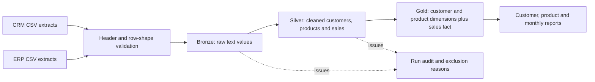
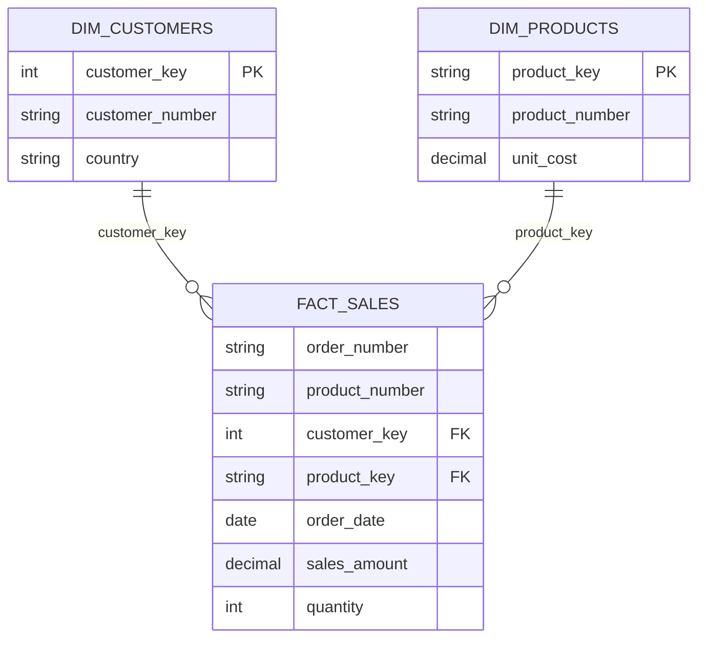

# Model, grain and data rules

## Data flow

A complete refresh is one transaction. If any file, transformation or final quality assertion fails, the previous Bronze/Silver data and Gold results are retained. A separate run record is marked FAILED and the SQL error is rethrown. A transaction-scoped application lock prevents concurrent refreshes. Scripts only create missing objects; they never drop the original `DataWarehouse` database. This implementation uses a separate `PortfolioWarehouse` database.

## Gold star model

- `gold.dim_customers`: one row per accepted CRM customer ID. `customer_key` is the source ID, not a new surrogate ID.
- `gold.dim_products`: one current product row per product number. `product_key` combines product number and current version start date; it is not a persistent generated surrogate. Do not join exports from different refreshes without re-exporting the entire model.
- `gold.fact_sales`: one order/product line. More than one row with the same order/product pair is considered ambiguous and all such rows are excluded. This source contract does not support split lines with the same order/product.
- Fact-to-dimension relationships: many-to-one through `customer_key` and `product_key`.
- `gold.report_customers`, `gold.report_products`, `gold.sales_trends`: reusable analytical views. Non-buying customers and unsold products remain in dimensions but are absent from buyer/sales reports.

Requirements specify a latest snapshot, not a historical warehouse. Silver retains source product revisions so a current record can be selected; Gold uses the latest version. This is not change-data capture, an incremental load, or a maintained SCD Type 2 implementation.

## Cleaning and exclusions

- CSV contracts check six filenames case-insensitively, exact header order, nonempty files and field counts. Staging preserves field values and normalizes encoding. SQL raw columns have a 255-character contract.
- CRM customer IDs/codes are required. Latest creation date wins per ID; text tie-breakers make selection deterministic. Duplicate codes across IDs select the latest creation date and highest ID. Exclusions are logged.
- ERP customer IDs remove a leading NAS prefix; ERP location IDs remove hyphens. CRM gender takes precedence; ERP fills unknown values. Invalid/future birth dates become NULL relative to the run's as-of date. Missing demographic/location data remains Unknown/NULL.
- Duplicate ERP keys use documented deterministic selection: birth-date text descending then gender; location country ascending; category/subcategory/maintenance ascending. This is a reproducible demo rule, not a validated source-system precedence rule.
- Product source keys contain a five-character category prefix and delimiter; the remainder is the product number. Category hyphens become underscores. Product revisions are ordered by valid-from; the latest is current. Invalid costs stay NULL, not zero; unknown cost is flagged.
- Sales require an order/product key, positive integer quantity, valid dates and nonnegative decimal amounts. Sales dates are exactly eight-character YYYYMMDD values; ship/due dates cannot precede order date. A late shipment after its due date is allowed.
- Sales amount must equal quantity × unit price within 0.01 source monetary units. Inconsistent amounts are excluded rather than silently repaired. Missing customers/products are excluded and logged. The first applicable rejection reason is recorded for each excluded sales row.
- Source sales count must equal accepted sales plus excluded sales. Gold joins must neither multiply nor lose accepted lines; Silver and Gold amount totals must agree. An order assigned to multiple customers aborts the refresh.

## Metric definitions and limits

- Sales: sum of accepted `sales_amount`. This is source transaction value, not accounting revenue recognition, collected cash or profit.
- Average order value: accepted sales divided by distinct accepted orders in the same group. Customer averages must not be averaged again to produce a company average.
- Known-cost gross profit: sales minus quantity × **current** product cost for lines with known cost. This is a latest-cost estimate, not historical realised profit. Unknown-cost lines remain NULL and their count is reported. No operating expenses, tax, refunds, FX or revenue-recognition adjustments are modelled.
- No currency column exists in the source contract. Amounts are reported in source monetary units; single-currency comparability is an assumption, not a verified FX treatment.
- Monthly sales uses order date. Months with no accepted sales are absent. `sales_trends.gap_months` distinguishes adjacent months from gaps; month-on-month percentages are reported only across adjacent observed months. Partial first/last months must not be compared as full periods.
- Customer recency uses the last observed order date as the dataset reference, not today's date. Purchase frequency describes observed orders, not a churn or lifetime-value prediction.

## Power BI use

Connect to SQL Server and load `gold.fact_sales`, `gold.dim_customers`, `gold.dim_products`. Create single-direction, many-to-one relationships from facts to dimensions on the two keys. Use a date table for full calendars and connect its date to order_date. Alternatively import all matching CSV exports from one refresh via `tools/export_reports.py`. SQL transformations and report views are implemented; a new PBIX dashboard is not included in this continuation.
